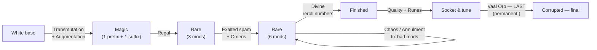

# Crafting — Index

> Snapshot 2026-11-17, patch 0.5.x · 1.0 crafting changes at the bottom. Currency catalog (values/effects): [items/currency.md](../items/currency.md).

## The crafting loop at a glance

!!! tip "Golden rules"
    - **Vaal Orb always last** — corruption is permanent and final.
    - **Hinekora's Lock** before any risky currency — it shows the outcome first.
    - **Omens** are your steering wheel: prefix/suffix control turns Exalted spam into targeted crafting.
    - Fracture **only after** the mod layout is perfect ([fractured-desecration.md](fractured-desecration.md)).

!!! warning "Don't do this"
    - Vaaling a Mirror-tier item without an Omen of Corruption — can brick it.
    - Chaos-spamming after fracturing — the fractured mod is locked forever.
    - Crafting on a base without checking ilvl gates ([modifiers-tiers.md](modifiers-tiers.md)).

## Crafting systems

| File | System | Difficulty |
|---|---|---|
| [currency-crafting.md](currency-crafting.md) | Orbs, mod slots per rarity, the crafting loop, Jeweller's Orbs | ★ beginner |
| [essences.md](essences.md) | Lesser→Perfect essence tiers, guaranteed mods | ★ beginner |
| [omens.md](omens.md) | Ritual's craft-controlling consumables (Sinistral/Dextral) | ★★ |
| [corruption.md](corruption.md) | Vaal Orbs, outcomes on gear/gems/uniques, Altars of Corruption | ★★ |
| [augments.md](augments.md) | Socketing runes/soul cores, extraction rules | ★ beginner |
| [runeforging.md](runeforging.md) | Verisium Anvil, Runic Ward, Runic Alloys, Fluxes (0.5.0) | ★★ |
| [idols.md](idols.md) | Idol acquisition & (non-)rerolling | ★★ |
| [jewels.md](jewels.md) | Catalysts, Emotions, Time-Lost Jewels crafting | ★★★ |
| [quality-sockets.md](quality-sockets.md) | Whetstones/Scrap/Etchers/GCP, Artificer's Orbs | ★ beginner |
| [fractured-desecration.md](fractured-desecration.md) | Fracturing Orb, Abyss Desecration, 1.0 Forgemarked | ★★★ |
| [benches-trade.md](benches-trade.md) | Salvage/Reforging benches, vendor recipes, Faustus & Ange | ★ beginner |
| [modifiers-tiers.md](modifiers-tiers.md) | Mod tiers, prefix/suffix rules, ilvl gates cheat sheet | ★★ reference |
| [1-0-crafting.md](1-0-crafting.md) | Conquerors of Wraeclast: Crimson Iron, Infused Blood | new in 1.0 |

## TL;DR crafting loop (rare item)

1. White base → **Transmutation** → **Augmentation** (fill Magic slots).
2. Evaluate → **Regal** → **Exalted** spam to 6 mods (use **Omens** to control prefix/suffix).
3. Fix with **Chaos** (swap a mod) / **Annulment** (remove a mod).
4. **Divine** the numbers, add quality currency, socket runes, then **Vaal Orb last** (corruption is final).
