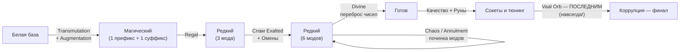

# Крафт — Индекс

> Снимок 2026-11-17, патч 0.5.x · изменения крафта 1.0 — внизу. Каталог валюты (значения/эффекты): [items/currency.md](../items/currency.md).

## Цикл крафта одним взглядом

!!! tip "Золотые правила"
    - **Vaal Orb всегда последним** — коррупция permanent и финальна.
    - **Hinekora's Lock** перед любой рискованной валютой — показывает исход заранее.
    - **Омены** — ваш руль: контроль префиксов/суффиксов превращает спам Exalted в таргет-крафт.
    - Фрактура — **только после** идеальной раскладки модов ([fractured-desecration.md](fractured-desecration.md)).

!!! warning "Так делать не надо"
    - Vaal Orb по предмету уровня Mirror без Omen of Corruption — можно убить.
    - Спам Chaos после фрактуры — фрактурованный мод заблокирован навсегда.
    - Крафт на базе без проверки ограничений ilvl ([modifiers-tiers.md](modifiers-tiers.md)).

## Системы крафта

| Файл | Тема | Сложность |
|---|---|---|
| [currency-crafting.md](currency-crafting.md) | Орбы, слоты модов по редкости, цикл крафта, Jeweller's Orbs | ★ новичок |
| [essences.md](essences.md) | Тиры эссенций Lesser→Perfect, гарантированные моды | ★ новичок |
| [omens.md](omens.md) | Расходники Ритуала для контроля крафта (Sinistral/Dextral) | ★★ |
| [corruption.md](corruption.md) | Vaal Orb, исходы для экипировки/камней/уников, Алтари Коррупции | ★★ |
| [augments.md](augments.md) | Вставка рун/ядер душ, правила извлечения | ★ новичок |
| [runeforging.md](runeforging.md) | Verisium Anvil, Runic Ward, Runic Alloys, Fluxes (0.5.0) | ★★ |
| [idols.md](idols.md) | Получение идолов и (не)перебрасывание | ★★ |
| [jewels.md](jewels.md) | Катализаторы, Эмоции, крафт Time-Lost Jewels | ★★★ |
| [quality-sockets.md](quality-sockets.md) | Whetstones/Scrap/Etchers/GCP, Artificer's Orbs | ★ новичок |
| [fractured-desecration.md](fractured-desecration.md) | Fracturing Orb, Desecration Бездны, Forgemarked 1.0 | ★★★ |
| [benches-trade.md](benches-trade.md) | Верстаки утилизации/перековки, рецепты торговцев, Faustus и Ange | ★ новичок |
| [modifiers-tiers.md](modifiers-tiers.md) | Тиры модов, правила префиксов/суффиксов, шпаргалка по ограничениям ilvl | ★★ справочник |
| [1-0-crafting.md](1-0-crafting.md) | Conquerors of Wraeclast: Crimson Iron, Infused Blood | новое в 1.0 |

## TL;DR цикл крафта (редкий предмет)

1. Белая база → **Transmutation** → **Augmentation** (заполнить слоты Магического).
2. Оценить → **Regal** → спам **Exalted** до 6 модов (используйте **Омены** для контроля префиксов/суффиксов).
3. Чинить через **Chaos** (заменить мод) / **Annulment** (убрать мод).
4. **Divine** для чисел, добавить валюту качества, вставить руны, затем **Vaal Orb последним** (коррупция финальна).
