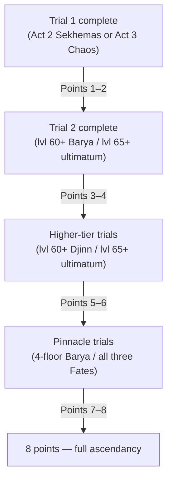

# Ascendancy Unlock Guide

> Sources: [Maxroll trials](https://maxroll.gg/poe2/getting-started/trials-of-ascendancy), [mechanics/league-mechanics.md](../mechanics/league-mechanics.md)

## Key rule (current patches)

**Ascendancy choice is NOT bound to a specific trial** — complete either trial to freely pick any ascendancy of your class. (Launch-era "class↔trial binding" info is outdated. Exception: **Abyssal Lich** — unlocked via the Well of Souls, not a trial — see [ascendancies/lich.md](../ascendancies/lich.md).)

## Trials

### Trial of the Sekhemas (Act 2)

- Entry item: **Barya** (drops in Act 2+).
- Solo-only multi-floor gauntlet; damage drains **Honour** — at 0 Honour the run ends.
- Manage Honour: avoid hits, use relics to balance risk/reward.
- Boss: **Balbala**. 4th floor ("Trial of Time") grants the 4th ascendancy point.
- Rewards: caches (Royal=jewels, Hoarder=gold, Warrior=gear), Time-Lost chests, pinnacle **Zarokh, the Temporal**.
- Planned upgrade missed 1.0 (Rogers) — coming "fairly shortly after launch".

### Trial of Chaos (Act 3)

- Entry item: **Inscribed Ultimatum** (Doryani's device).
- Choose **Ordeals** (curses) for **Boons**; up to 10 chambers.
- 4th point requires 10-floor completions collecting **3 trial fragments**.
- Trialmaster drops **Vaal Orbs** and **Soul Cores**. Major rework in 0.5.5.

## Points schedule

| Points | Requirement |
|---|---|
| 1–2 | First trial completion (Acts 2–3) |
| 3–4 | Second trial (Sekhemas lvl 60+ Barya / Chaos lvl 65+ 10-round ultimatum) |
| 5–6 | lvl 60+ Djinn Barya / lvl 65+ 10-round ultimatum |
| 7–8 | 4-floor pinnacle Barya / lvl 65+ ultimatum with all three Fates |

## Choosing an ascendancy

- Read your class table: [classes/](../classes/) → ascendancy files for full node lists.
- Decision shortcuts: [class-selection.md](class-selection.md).
- Points are reallocated with gold (respec) if you change your mind.
