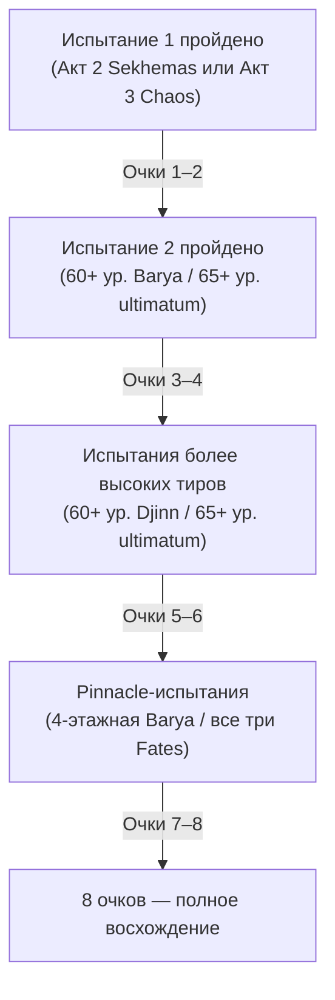

# Гайд по открытию восхождений

> Источники: [Maxroll trials](https://maxroll.gg/poe2/getting-started/trials-of-ascendancy), [mechanics/league-mechanics.md](../mechanics/league-mechanics.md)

## Ключевое правило (текущие патчи)

**Выбор восхождения НЕ привязан к конкретному испытанию** — пройдите любое из испытаний, чтобы свободно выбрать любое восхождение своего класса. (Информация эпохи запуска о «привязке класс↔испытание» устарела. Исключение: **Abyssal Lich** — открывается через Well of Souls, а не через испытание — см. [ascendancies/lich.md](../ascendancies/lich.md).)

## Испытания

### Trial of the Sekhemas (Акт 2)

- Предмет входа: **Barya** (дропается с Акта 2+).
- Только соло, многоэтажная полоса препятствий; урон расходует **Honour** — при 0 Honour забег заканчивается.
- Управляйте Honour: избегайте ударов, используйте реликвии для баланса риска и награды.
- Босс: **Balbala**. 4-й этаж («Trial of Time») даёт 4-е очко восхождения.
- Награды: тайники (Royal=джевелы, Hoarder=золото, Warrior=экипировка), Time-Lost сундуки, пиннакл **Zarokh, the Temporal**.
- Запланированное обновление пропущено 1.0 (Rogers) — выйдет «вскоре после запуска».

### Trial of Chaos (Акт 3)

- Предмет входа: **Inscribed Ultimatum** (устройство Дориани/Doryani).
- Выбирайте **Ordeals** (проклятия) ради **Boons**; до 10 залов.
- 4-е очко требует прохождений на 10 этажей со сбором **3 фрагментов испытания**.
- Trialmaster дропает **Vaal Orbs** и **Soul Cores**. Крупный реворк в 0.5.5.

## Расписание очков

| Очки | Требование |
|---|---|
| 1–2 | Первое прохождение испытания (Акты 2–3) |
| 3–4 | Второе испытание (Sekhemas Barya 60+ ур. / Chaos ultimatum 65+ ур. на 10 раундов) |
| 5–6 | Djinn Barya 60+ ур. / ultimatum 65+ ур. на 10 раундов |
| 7–8 | 4-этажная пиннакл-Barya / ultimatum 65+ ур. со всеми тремя Fates |

## Выбор восхождения

- Прочитайте таблицу своего класса: [classes/](../classes/) → файлы восхождений с полными списками нод.
- Быстрые пути к решению: [class-selection.md](class-selection.md).
- Очки перераспределяются за золото (респек), если передумаете.
