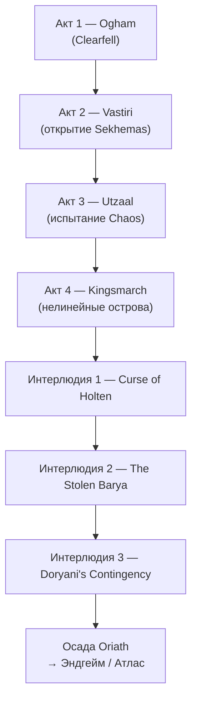

# Оптимальный маршрут кампании (Акты 1–4 + Интерлюдии)

> Источник: [Maxroll Campaign Guide](https://maxroll.gg/poe2/getting-started/path-of-exile-2-campaign-guide). Награды за квесты: [campaign-quests.md](campaign-quests.md). Советы: [leveling.md](leveling.md)

## Акт 1 — Ogham (город: Clearfell)

Торговцы: Renly (оружие/броня), Una (кастер + расщепление), Finn (золото/азартная игра), **Farrow → Runeforging** (квест «The Runeseeker»).

1. The Riverbank (Bloated Miller) → Clearfell (**Beira: +10% Cold Res**) → Mud Burrow (Devourer, Support Gem) → Grelwood → Red Vale (Rust King).
2. Grelwood (Tree of Souls) → Grim Tangle (Ervig) → Cemetery of the Eternals → Tomb of the Consort (Asinia) → Mausoleum (Draven) → Cemetery (Lachlann).
3. **Freythorn (King in the Mists: +30 Spirit)** → Hunting Grounds (**Crowbell: +2 очка**) → Farmlands (**Una's Lute: +2 очка**) → Ogham Village (**инструменты Renly = Salvage Bench**) → Manor Ramparts → Ogham Manor (**Candlemass: +20 Life** → **Count Geonor** босс акта).

## Акт 2 — Vastiri (города: Vastiri Outskirts → Ardura Caravan; **Risu** присоединяется после Rudja)

1. Mawdun Quarry → Mawdun Mine (Rudja) → Traitor's Passage (**Balbala → Djinn Barya, открывает Sekhemas**) → Halani Gates (Jamanra, the Risen King).
2. Mastodon Badlands → Bone Pits (**Sun Clan Relic**) → Keth (**Kabala: +2 очка**) → Valley of the Titans (**Ancient Vows: +1 Charm Slot**).
3. Lost City → Buried Shrines (Azarian) → Titan Grotto (Zalmarath) → Deshar → Spires of Deshar (Tor Gul; **возьмите алтарь +10% Lightning Res**) → Dreadnought (**Jamanra, the Abomination** босс акта).

## Акт 3 — Utzaal (города: Sandswept Marsh → Ziggurat Encampment; **Alva**)

1. Sandswept Marsh (Rootdredge; Orok Basket = Jeweller's Orb) → Jungle Ruins (**Mighty Silverfist: +2 очка**) → **Venom Crypts (Draught — ПОСТОЯННЫЙ выбор)**.
2. Infested Barrens → Chimeral Wetlands (Xyclucian; побочная зона **Temple of Chaos = Trial of Chaos**) → Jiquani's Machinarium (**Blackjaw: +10% Fire Res**) → Jiquani's Sanctum (Zicoatl).
3. Matlan Waterways → **Azak Bog (Ignagduk: +30 Spirit)** → Drowned City → **Molten Vault (Mektul = Reforging Bench, таймер 4 мин)** → Apex of Filth → Temple of Kopec (Ketzuli).
4. Utzaal Past (Viper Napuatzi; Sacrificial Heart) → **Aggorat Past (Blood Sacrifice: +2 очка)** → Black Chambers → **Doryani, Royal Thaumaturge** финал акта.

## Акт 4 — Kingsmarch (нелинейный; город: Dannig/Rog/Tujen азартная игра, **Ange** обмен, плавание Makoru)

1. Isle of Kin (Blank Greater Rune) → Volcanic Warrens (Krutog) → Kedge Bay → Journey's End (**Omniphobia: +2 очка**) → Abandoned Prison (**бафф флакона Goddess of Justice**) → Solitary Confinement.
2. Whakapanu Island (Great White One → **Kaimana Lesson, ПОСТОЯННЫЙ**) → Singing Caverns (Diamora) → Shrike Island → Eye of Hinekora (**Silent Hall: +5% Mana**).
3. Halls of the Dead (**3 Tattoos ПОСТОЯННЫЕ**; **Yama: +2 очка**).
4. Arastas (Torvian) → The Excavation (Benedictus) → Ngakanu → Heart of the Tribe (**Tavakai** босс акта).

## Интерлюдии (удаляются, когда на 1.0 выйдут Акты 5–6)

**I1 Curse of Holten** (город: The Refuge): Scorched Farmlands → Stones of Serle → Blackwood → Holten (Ferryman продаёт Greater Runes) → Wolvenhold (**Oswin: +2 очка**) → Holten Estate (Elswyth — соло-подход).

**I2 The Stolen Barya** (город: Khari Bazaar): Khari Crossing (**Akthi & Anundr: +2 очка**; **Molten Shrine: +5% Life**) → Pools of Khatal → Sel Khari Sanctuary → Galai Gates → **Qimah (бафф Seven Pillars)** → Qimah Reservoir (Azmadi).

**I3 Doryani's Contingency** (город: The Glade): Ashen Forest → Kriar Village (**Lythara: +40 Spirit**) → Glacial Tarn → Howling Caves (**Yeti: +2 очка**) → Kriar Peaks (**Elder Madox: бесплатный уник**) → Etched Ravine → Cuachic Vault.

**Финал:** вернуться в Kingsmarch → Hooded One «Siege of Oriath» (**+2 очка**) → Oriath → **эндгейм/Атлас**.

## Общие правила

- Необязательных боссов с постоянными бонусами убивайте, не покидая их зону (список: [campaign-quests.md](campaign-quests.md)).
- Испытания: Sekhemas открывается в Акте 2, Chaos в Акте 3 — пройдите оба пораньше ради очков восхождения.
- Зоны полуоткрытые; приведённый порядок минимизирует возвраты для сдачи квестов.
