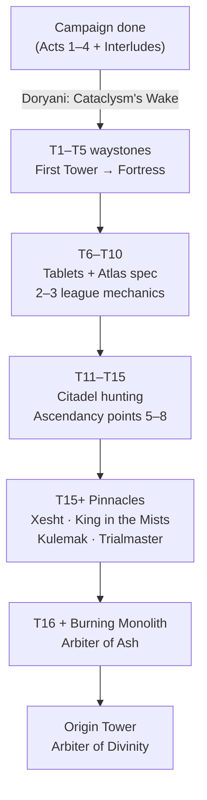

# Endgame Progression Guide

> Loop details: [mechanics/atlas-waystones.md](../mechanics/atlas-waystones.md) · Pinnacle list: [mechanics/pinnacle-bosses.md](../mechanics/pinnacle-bosses.md)

## The roadmap

## Phase 1 — Enter the endgame

1. Finish Acts 1–4 + Interludes; Doryani's "Cataclysm's Wake" starts the endgame.
2. Get T1 waystones (Doryani sells up to 10).
3. First Tower clear → the **Fortress** rises; Fortress sections grant Atlas passives (T6/T11/T14 storyline).

## Phase 2 — Tier climb (T1 → T16)

- Map bosses drop +1 tier; 3 same-tier waystones reforge into 1 higher tier.
- Sustain: Atlas nodes, waystone Waystone Drop Chance suffix, tablets, unidentified-waystone trick (+30% drops).
- Socket **Precursor Tablets** into the Map Device (3 slots, unlocked by map modifiers).
- 6 respawn portals per map — use them on bosses.

## Phase 3 — Systems to engage

- Pick 2–3 league mechanics to invest Atlas points into (Breach/Ritual/Expedition/Abyss/Delirium/Vaal/Runes of Aldur) — each has a guided questline to its pinnacle (0.5.0).
- Do both **Trials** for ascendancy points 5–8 ([ascendancy-unlock.md](ascendancy-unlock.md)).
- Start **Runeforging** (Verisium) and Abyss Desecration for deterministic upgrades ([crafting/](../crafting/index.md)).

## Phase 4 — Pinnacles (rough order of difficulty)

| Step | Target | Key |
|---|---|---|
| 1 | Citadels (T15+) → Act bosses | Crisis Fragments ×3 |
| 2 | Breach Domains → Tul & Esh | Xesht key |
| 3 | Ritual → King in the Mists → Rite of the Nameless | 5-map chain |
| 4 | Simulacrum 7 waves | Omniphobia/Kosis |
| 5 | Abyssal Depths → 3 Lightless → Kulemak | Invitation → Well of Souls |
| 6 | Sekhemas depth / Chaos 10-floor | Zarokh / Trialmaster |
| 7 | Burning Monolith | **Arbiter of Ash** |
| 8 | Origin Tower | **Arbiter of Divinity** (0.5.0) |

## Death economics

!!! danger "XP penalty"
    From ~level 65 every death in map-device areas costs **10% of the XP toward your current level** (you cannot de-level). Avoid risky mods (Volatile Fiends, Deadly Monsters) while leveling to 100 — see [mechanics/death-trade-party.md](../mechanics/death-trade-party.md).

## 1.0 changes (Dec 11, 2026)

- Atlas tree condensed to ~70 multi-choice nodes (~50 points by pinnacle); passive tree jewel sockets rework; faction castle sieges — see [1.0/confirmed.md](../1.0/confirmed.md).
