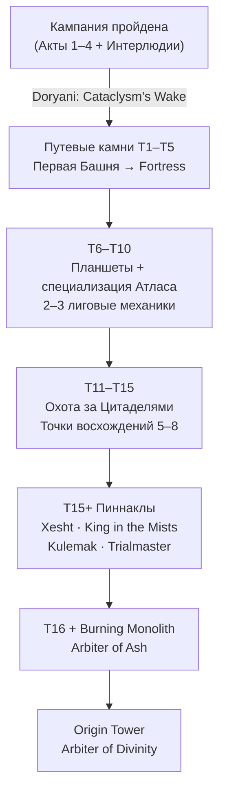

# Гайд по прогрессии в эндгейме

> Подробности цикла: [mechanics/atlas-waystones.md](../mechanics/atlas-waystones.md) · Список пиннаклов: [mechanics/pinnacle-bosses.md](../mechanics/pinnacle-bosses.md)

## Дорожная карта

## Фаза 1 — Вход в эндгейм

1. Завершите Акты 1–4 + Интерлюдии; «Cataclysm's Wake» Дориани (Doryani) запускает эндгейм.
2. Получите путевые камни (Waystone) T1 (Doryani продаёт до 10).
3. Первое прохождение Башни (Tower) → поднимается **Fortress**; секции Fortress дают пассивки Атласа (сюжетная линия T6/T11/T14).

## Фаза 2 — Подъём по тирам (T1 → T16)

- Боссы карт дропают +1 тир; 3 путевых камня одного тира перековываются в 1 камень более высокого тира.
- Поддержание запаса (sustain): ноды Атласа, суффикс Waystone Drop Chance у путевых камней, планшеты (tablets), трюк с неопознанными камнями (+30% дропа).
- Вставляйте **Precursor Tablets** в Map Device (3 гнезда, открываются модификаторами карт).
- 6 порталов возрождения на карту — используйте их на боссах.

## Фаза 3 — Системы, к которым стоит подключиться

- Выберите 2–3 лиговые механики, в которые вложите очки Атласа (Breach/Ritual/Expedition/Abyss/Delirium/Vaal/Runes of Aldur) — у каждой есть ведущая квестовая цепочка до её пиннакла (0.5.0).
- Пройдите оба **Испытания** ради очков восхождения 5–8 ([ascendancy-unlock.md](ascendancy-unlock.md)).
- Начните **Runeforging** (Verisium) и Abyss Desecration для детерминированных улучшений ([crafting/](../crafting/index.md)).

## Фаза 4 — Пиннаклы (примерный порядок по сложности)

| Шаг | Цель | Ключ |
|---|---|---|
| 1 | Citadels (T15+) → боссы актов | Crisis Fragments ×3 |
| 2 | Breach Domains → Tul & Esh | Ключ Xesht |
| 3 | Ritual → King in the Mists → Rite of the Nameless | Цепочка из 5 карт |
| 4 | Simulacrum 7 волн | Omniphobia/Kosis |
| 5 | Abyssal Depths → 3 Lightless → Kulemak | Invitation → Well of Souls |
| 6 | Глубина Sekhemas / Chaos 10 этажей | Zarokh / Trialmaster |
| 7 | Burning Monolith | **Arbiter of Ash** |
| 8 | Origin Tower | **Arbiter of Divinity** (0.5.0) |

## Экономика смерти

!!! danger "Штраф опыта"
    С ~65 уровня каждая смерть в зонах карт-девайса забирает **10% опыта до текущего уровня** (деклассирование невозможно). Избегайте опасных модов (Volatile Fiends, Deadly Monsters) при прокачке до 100 — см. [mechanics/death-trade-party.md](../mechanics/death-trade-party.md).

## Изменения 1.0 (11 декабря 2026)

- Дерево Атласа сжато до ~70 нод с множественным выбором (~50 очков к пиннаклу); реворк гнёзд джевелов на дереве пассивок; осады замков фракций — см. [1.0/confirmed.md](../1.0/confirmed.md).
