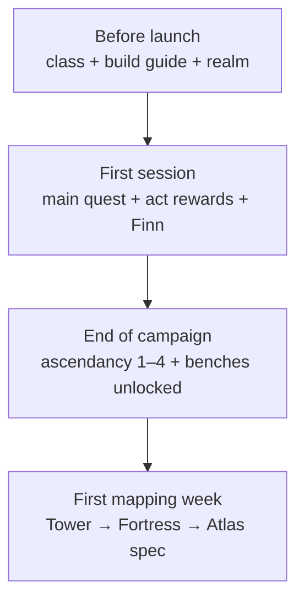

# League Start Checklist

> For fresh league day 1 (pattern holds for 0.5.x; refresh after 1.0).

!!! warning "Common league-start mistakes"
    - Skipping permanent act rewards (they are gone once you leave the act).
    - Hoarding currency instead of using it while leveling.
    - Not checking 1.0 patch notes — reworked classes may invalidate your planned build.

## Before launch

- [ ] Pick class + rough ascendancy path ([class-selection.md](class-selection.md))
- [ ] Bookmark a league-start build guide (Maxroll/Mobalytics)
- [ ] Decide realm: Softcore / HC / SSF ([mechanics/death-trade-party.md](../mechanics/death-trade-party.md))
- [ ] Check patch notes for reworked classes (1.0 reworks Infernalist, Blood Mage, Acolyte of Chayula, Mercenary — [1.0/confirmed.md](../1.0/confirmed.md))

## First session

- [ ] Follow main quest; grab every permanent act reward
- [ ] Socket supports into one main skill; +life on all gear
- [ ] Keep resists near cap as acts progress
- [ ] Unlock Currency Exchange (Finn, Act 1) and sell unused orbs early for build currency
- [ ] Note trial locations (Sekhemas Act 2, Chaos Act 3)

## By end of campaign

- [ ] Ascendancy points 1–4 done
- [ ] Runeforging unlocked (Farrow, Act 1 — [crafting/runeforging.md](../crafting/runeforging.md))
- [ ] Salvage/Reforging benches unlocked
- [ ] Doryani's Cataclysm's Wake → first waystones

## First mapping week

- [ ] Tower clear → Fortress → Atlas points
- [ ] Tablet sockets on Map Device
- [ ] Pick Atlas specialization (2–3 league mechanics)
- [ ] 3→1 waystone reforges to climb tiers
- [ ] Plan pinnacle keys: Crisis Fragments, Xesht key, Rite of the Nameless
- [ ] Save Vaal Orbs for final item passes ([crafting/corruption.md](../crafting/corruption.md))
