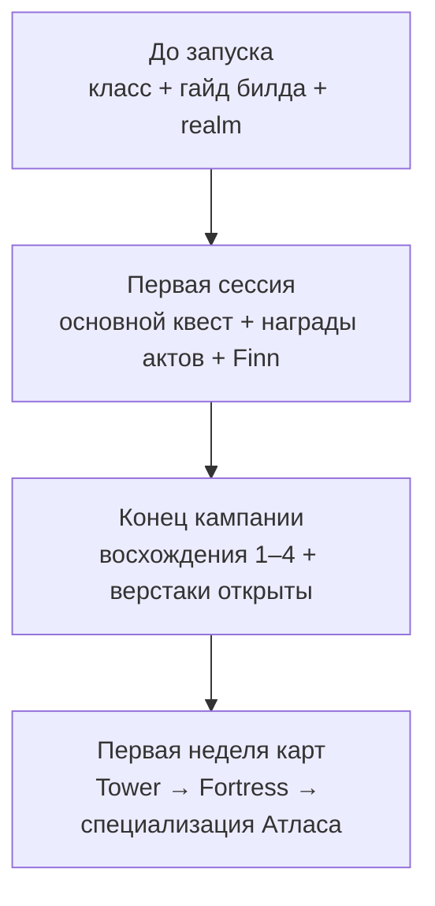

# Чеклист старта лиги

> Для первого дня свежей лиги (паттерн действует для 0.5.x; обновить после 1.0).

!!! warning "Частые ошибки старта лиги"
    - Пропуск постоянных наград актов (они исчезают, когда вы покидаете акт).
    - Накопление валюты вместо её использования во время левелинга.
    - Непрочитанные патчноуты 1.0 — переработанные классы могут обесценить запланированный билд.

## До запуска

- [ ] Выбрать класс + примерный путь восхождения ([class-selection.md](class-selection.md))
- [ ] Сохранить в закладки гайд по билду для старта лиги (Maxroll/Mobalytics)
- [ ] Решить мир: Softcore / HC / SSF ([mechanics/death-trade-party.md](../mechanics/death-trade-party.md))
- [ ] Проверить патчноуты на реворкнутые классы (1.0 реворкнет Infernalist, Blood Mage, Acolyte of Chayula, Mercenary — [1.0/confirmed.md](../1.0/confirmed.md))

## Первая сессия

- [ ] Следовать основному квесту; забрать каждую постоянную награду актов
- [ ] Вставить саппорты в одно главное умение; +жизни на всю экипировку
- [ ] Держать резисты близко к капу по мере продвижения по актам
- [ ] Открыть Currency Exchange (Finn, Акт 1) и рано продать неиспользуемые сферы ради валюты на билд
- [ ] Отметить локации испытаний (Sekhemas Акт 2, Chaos Акт 3)

## К концу кампании

- [ ] Очки восхождения 1–4 получены
- [ ] Runeforging открыто (Farrow, Акт 1 — [crafting/runeforging.md](../crafting/runeforging.md))
- [ ] Верстаки Salvage/Reforging открыты
- [ ] Cataclysm's Wake Дориани (Doryani) → первые путевые камни

## Первая неделя картов

- [ ] Прохождение Башни (Tower) → Fortress → очки Атласа
- [ ] Гнёзда планшетов на Map Device
- [ ] Выбрать специализацию Атласа (2–3 лиговые механики)
- [ ] Перековки путевых камней 3→1 для подъёма тиров
- [ ] Запланировать ключи пиннаклов: Crisis Fragments, ключ Xesht, Rite of the Nameless
- [ ] Копить Vaal Orbs на финальные прогоны предметов ([crafting/corruption.md](../crafting/corruption.md))
