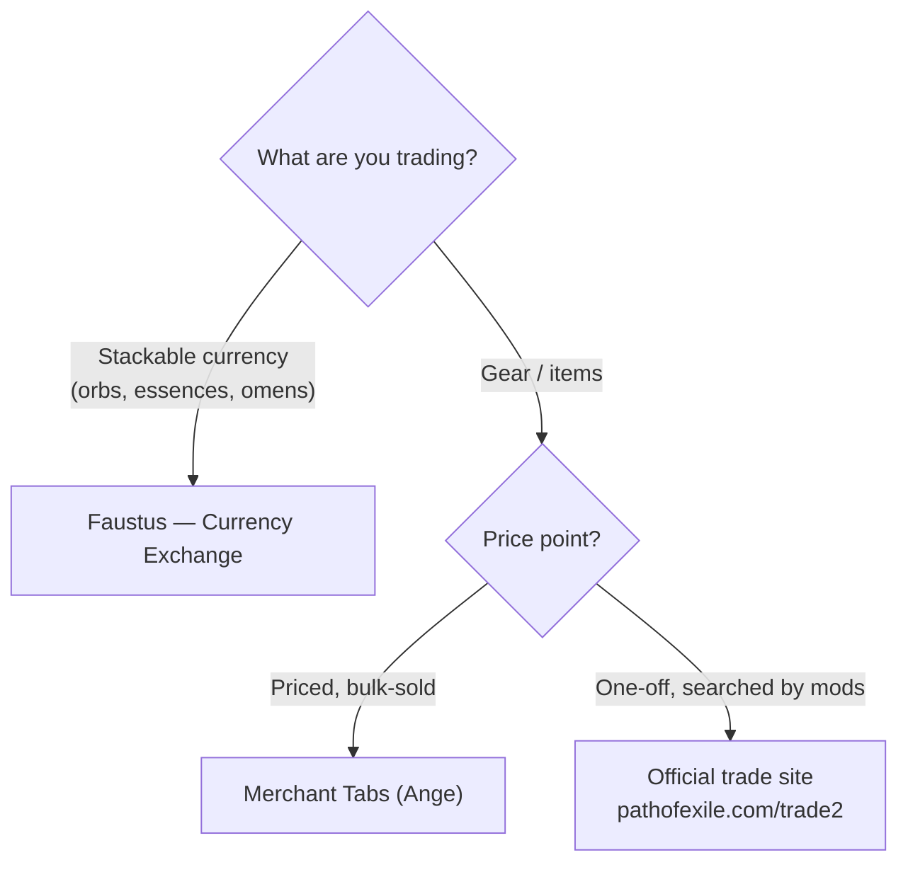

# Trade Guide

> Systems: [mechanics/death-trade-party.md](../mechanics/death-trade-party.md) · [crafting/benches-trade.md](../crafting/benches-trade.md)

## Currency trading — Faustus (Currency Exchange)

1. Find Finn (Act 1 Clearfell), Risu (Act 2), Alva (Act 3/hideout), or Ange (0.5.5-era).
2. Place buy/sell orders for stackable currency (orbs, essences, omens, splinters…).
3. Orders complete asynchronously at market rate; posting costs **Gold** (scales with value).

## Item trading — Merchant Tabs (Ange, 0.3.0+)

1. Unlock Merchant Tabs in your hideout.
2. List gear at a chosen price; buyers pay the gold fee — **sellers pay nothing**.
3. Sales complete offline (asynchronous).

## Item-for-item — official trade site

- [pathofexile.com/trade2](https://www.pathofexile.com/trade2): search by mods, whisper or one-click invite/pickup in-game.

## Practical rules

- Price check rares before vendoring: 6-mod rares, high-tier bases, and fractured items often trade well.
- **Divine Orbs** and **Mirrors** are the high-end trade currency; Exalted is the workhorse.
- Never trade with strangers outside official channels — scams and RMT risk.
- 1.0 outlook: further async movement expected; no automated auction house announced — see [1.0/rumors.md](../1.0/rumors.md).
