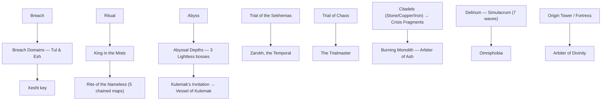

# League Mechanics (core in 0.5.x)

> Sources: [Fextralife Endgame Guide](https://pathofexile2.wiki.fextralife.com/Endgame_Guide), [Mobalytics league guides](https://mobalytics.gg/poe-2/guides), official patch notes.

Core-in-Atlas mechanics (0.5.x): **Abyss, Breach, Ritual, Expedition, Delirium, Fate of the Vaal, Runes of Aldur**, plus **Trials** and Azmeri content.

## Breach

- Interact with a hand/claw; kill monsters fast to extend a timed expanding zone (progress bar since 0.5; 100% = **stabilised Breach** spawning **Vruun, Marshal of Xesht**).
- Rewards: Breach Splinters (combine into Breachstones), **Hiveblood/Wombgifts** used at the **Genesis Tree** to craft rings/amulets/belts/currency and Breachstones.
- **Breach Domains** (Hives/Sky Hives/Fortresses) with Tul & Esh dropping the Xesht key. Monastery of the Keepers region grants Breach Atlas points.

## Ritual

- Activate altars, kill all waves, earn **Tribute** to buy rewards — endgame Ritual rewards are **exclusively Uniques or Omens**.
- Unaffordable items can be **deferred for 15% of price** (10% + 5% fee) and return later.
- Unspent tribute buys an audience with **King in the Mists**; **Rite of the Nameless** chains 5 maps of escalating Rituals for the pinnacle key.
- Omens are Ritual's crafting currency — see [crafting/omens.md](../crafting/omens.md). Caer Tarth region (Aoife storyline).

## Expedition → Runes of Aldur

- Legacy Expedition: runestones/explosive chains around Remnants, detonate, kill unearthed waves; vendors Rog/Gwennen/Tujen/Dannig sell gear gambling for **Artifacts**; Logbooks → Grand Expeditions with bosses.
- In 0.5.0 Expedition was **reworked into Runes of Aldur** and became core from Act 4 onward (0.5.5: available in Standard); the **Recombinator was removed** in 0.5.0.

## Runes of Aldur (0.5.0 league, now core)

- Each area contains an **Ezomyte Remnant** — choose a combo of **Runes/Currency**, fight Rune-empowered waves; bigger combos (2–10 slots) = rarer rewards (e.g. Tempest+Lightning → Orb of Augmentation).
- Drops **Verisium** for **Runeforging** — see [crafting/runeforging.md](../crafting/runeforging.md).
- 150+ socketable Runes, Runic Alloys crafting, 30+ new monster types; dedicated Atlas tree added 0.5.4.

## Abyss

- Walk fissure cracks spawning enemies/troves; seals open an **Abyssal Pit** → boss or **Abyssal Depths** with **3 Lightless bosses** → **Kulemak's Invitation** → **Vessel of Kulemak** (Well of Souls → Abyssal Lich unlock).
- Rewards: **Gnawed Bones** (deterministic Desecration crafting), abyss jewels/uniques, Soul Cores-adjacent Augments.
- 0.5.5 added **Large Abyssal Ravines** (chained Abyss areas with a guaranteed final boss).

## Fate of the Vaal (0.4.0 league, now core)

- Ancient/Vaal **Beacons** in zones; build **Atziri's Temple** (Lira Vaal) room-by-room (rooms upgradeable to T4; Medallions; Infusers — Armourers/Blacksmiths/Arcanists/Catalysers — need ≥20% quality).
- **Vaal Cultivation Orb** rerolls Uniques. Pinnacle: **Queen Atziri**.

## Trial of the Sekhemas

- Roguelike floors where damage drains **Honour** (0 = fail); slot **Relics (Barya)** to scale difficulty/rewards.
- **4 floors**; reward caches (Royal=jewels, Hoarder=gold, Warrior=gear) and Time-Lost chests; pinnacle **Zarokh, the Temporal**.
- 0.5.5 added inherent modifiers at level 65+. Rogers (Nov 2026): Sekhemas upgrade missed 1.0, coming "fairly shortly after launch".

## Trial of Chaos

- **Doryani's device + Inscribed Ultimatums**; choose **Ordeals** (curses) for **Boons** and rewards; up to **10 chambers**.
- Trialmaster drops **Vaal Orbs** and **Soul Cores**. Major rework in 0.5.5 (Forbidden Rites).

## Wildwood / Azmeri

- Touch an **Azmerian Wisp** to gain a temporary buff; it then possesses/empowers a monster — killing it yields boosted rewards (**Talismans**, big rarity bonuses).
- Types: Primal (magic monsters), Wild (rarity/magic find), Vivid (rare modifiers); stacking buffs make empowered rares tanky.
- Ritual tablet + Atlas nodes increase spawns. Idols drop from possessed monsters. 0.5.x "Viridian Wildwood / Sacred Bloom" expansions reported `(unconfirmed)`.

## Delirium (core)

- Break mirrors → fog with progress bar; **Trial of Madness** spans the Atlas at 10–200% Deliriousness (capped at 100% in 0.5.5).
- **Simulacrum** = 7-wave encounter → Delirium pinnacle key (Omniphobia/Kosis).
- Rewards: Liquid/Potent/Ancient Emotions (jewel crafting, **Time-Lost Jewels**), Raven-Touched uniques.
