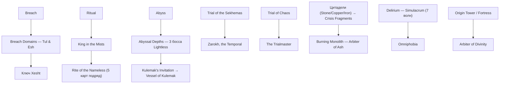

# Механики Лиг (основа в 0.5.x)

> Источники: [Fextralife Endgame Guide](https://pathofexile2.wiki.fextralife.com/Endgame_Guide), [Mobalytics league guides](https://mobalytics.gg/poe-2/guides), официальные патчноуты.

Механики, встроенные в Атлас (0.5.x): **Abyss, Breach, Ritual, Expedition, Delirium, Fate of the Vaal, Runes of Aldur**, плюс **Trials** и азмери-контент.

## Breach

- Взаимодействуйте с рукой/когтем; убивайте монстров быстро, чтобы продлить расширяющуюся зону с таймером (полоса прогресса с 0.5; 100% = **стабилизированный Breach**, спавнящий **Vruun, Marshal of Xesht**).
- Награды: Breach Splinters (собираются в Breachstones), **Hiveblood/Wombgifts** используются у **Genesis Tree** для крафта колец/амулетов/поясов/валюты и Breachstones.
- **Breach Domains** (Hives/Sky Hives/Fortresses) с Tul и Esh, дропающими ключ Xesht. Регион Monastery of the Keepers даёт очки Атласа Breach.

## Ritual

- Активируйте алтари, убивайте все волны, получайте **Tribute** для покупки наград — эндгейм-награды Ritual — **исключительно Uniques или Omens**.
- Неподъёмные по цене предметы можно **отложить за 15% цены** (10% + 5% комиссия), и они вернутся позже.
- Нерасплаченный tribute покупает аудиенцию у **King in the Mists**; **Rite of the Nameless** — цепочка из 5 карт с эскалирующими Ritual ради ключа пиннакла.
- Omens — крафтовая валюта Ritual — см. [crafting/omens.md](../crafting/omens.md). Регион Caer Tarth (сюжетная линия Aoife).

## Expedition → Runes of Aldur

- Легаси Expedition: рунные камни/взрывные цепочки вокруг Remnants, детонация, убийство выкопанных волн; торговцы Rog/Gwennen/Tujen/Dannig продают gambling-экипировку за **Artifacts**; Logbooks → Grand Expeditions с боссами.
- В 0.5.0 Expedition был **переработан в Runes of Aldur** и стал основой с Акта 4 (0.5.5: доступен в Standard); **Recombinator был удалён** в 0.5.0.

## Runes of Aldur (лига 0.5.0, теперь основа)

- В каждой зоне есть **Ezomyte Remnant** — выберите комбинацию **Рун/Валюты**, сражайтесь с волнами, усиленными Рунами; бо́льшие комбинации (2–10 слотов) = более редкие награды (например, Tempest+Lightning → Orb of Augmentation).
- Дропает **Verisium** для **Runeforging** — см. [crafting/runeforging.md](../crafting/runeforging.md).
- 150+ вставляемых Рун, крафт Runic Alloys, 30+ новых типов монстров; отдельное дерево Атласа добавлено в 0.5.4.

## Abyss

- Идите по трещинам расщелин, спавнящим врагов/тайники; печати открывают **Abyssal Pit** → босс или **Abyssal Depths** с **3 боссами Lightless** → **Kulemak's Invitation** → **Vessel of Kulemak** (Well of Souls → открытие Abyssal Lich).
- Награды: **Gnawed Bones** (детерминированный крафт Desecration), abyss-самоцветы/уники, аугменты рядом с Soul Cores.
- 0.5.5 добавил **Large Abyssal Ravines** (цепочки зон Abyss с гарантированным финальным боссом).

## Fate of the Vaal (лига 0.4.0, теперь основа)

- Древние/Vaal **Beacons** в зонах; стройте **Atziri's Temple** (Lira Vaal) комната за комнатой (комнаты апгрейдятся до T4; Medallions; Infusers — Armourers/Blacksmiths/Arcanists/Catalysers — нужно ≥20% качества).
- **Vaal Cultivation Orb** перероллит Uniques. Пиннакл: **Queen Atziri**.

## Trial of the Sekhemas

- Roguelike-этажи, где урон сливает **Honour** (0 = провал); вставляйте **Relics (Barya)** для масштабирования сложности/наград.
- **4 этажа**; наградные кеши (Royal=самоцветы, Hoarder=золото, Warrior=экипировка) и Time-Lost сундуки; пиннакл — **Zarokh, the Temporal**.
- 0.5.5 добавил встроенные модификаторы с 65 уровня. Rogers (ноябрь 2026): апгрейд Sekhemas не успел к 1.0, выйдет «вскоре после релиза».

## Trial of Chaos

- **Устройство Doryani + Inscribed Ultimatums**; выбирайте **Ordeals** (проклятия) ради **Boons** и наград; до **10 камер**.
- Trialmaster дропает **Vaal Orbs** и **Soul Cores**. Крупный реворк в 0.5.5 (Forbidden Rites).

## Wildwood / Azmeri

- Коснитесь **Azmerian Wisp**, чтобы получить временный бафф; затем он вселяется/усиливает монстра — убийство даёт усиленные награды (**Talismans**, большие бонусы редкости).
- Типы: Primal (магические монстры), Wild (редкость/magic find), Vivid (редкие модификаторы); стакающиеся баффы делают усиленных редких танковыми.
- Tablet Ритуала + узлы Атласа увеличивают спавны. Idols падают с одержимых монстров. Расширения 0.5.x «Viridian Wildwood / Sacred Bloom» сообщались `(не подтверждено)`.

## Delirium (основа)

- Разбивайте зеркала → туман с полосой прогресса; **Trial of Madness** покрывает Атлас на 10–200% Deliriousness (ограничено 100% в 0.5.5).
- **Simulacrum** = encounter на 7 волн → ключ пиннакла Delirium (Omniphobia/Kosis).
- Награды: Liquid/Potent/Ancient Emotions (крафт самоцветов, **Time-Lost Jewels**), уники Raven-Touched.
